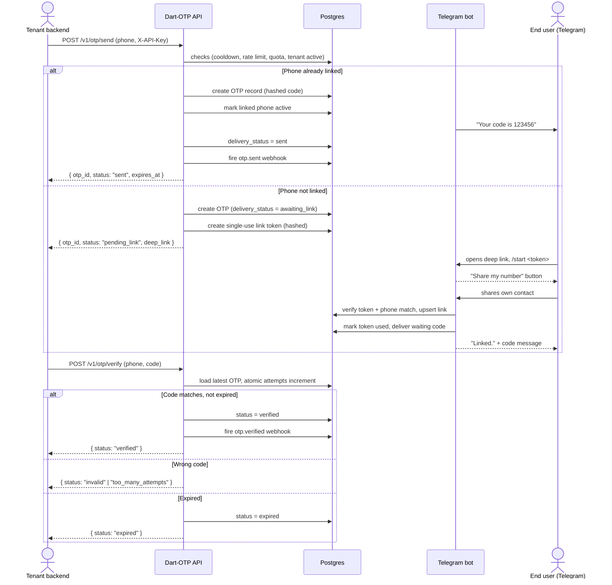
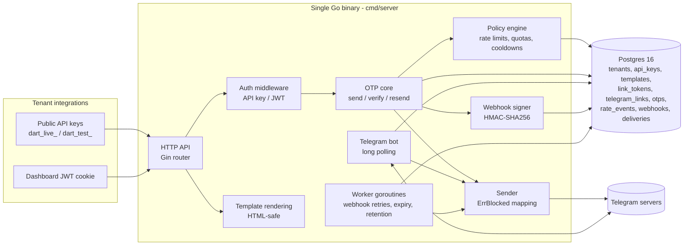

# Dart-OTP

**Passcodes without the phone bill.**

Dart-OTP is a hosted, tenant-ready OTP delivery API that sends one-time passcodes through **Telegram** instead of SMS. Businesses that already reach their users on Telegram — fintechs, community platforms, marketplaces, gaming products — can verify phone numbers in seconds, at a fraction of the cost of carrier SMS, with no number-pool management, no carrier filtering, and no delivery roulette.

This repository is the **backend**: the HTTP API, the Telegram bot, the delivery worker, and the Postgres-backed storage and policy engine.

---

## The problem

SMS-based OTP is the default for phone verification, and it is quietly broken:

- **Cost.** International A2P SMS pricing is volatile and punitive; a single verification can cost more than an entire month of a Telegram-bot-based delivery.
- **Reliability.** Carrier filtering, sender-ID rewriting, and regional routing rules silently drop messages.
- **Trust.** OTP-shaped SMS is the most abused attack surface in social engineering.
- **Visibility.** You pay for messages you cannot confirm were delivered.

Telegram inverts every one of these. Messages are free, delivery is confirmed, the channel is end-to-end encrypted at transport level, and the user is already there.

## The product

Dart-OTP is a **multi-tenant OTP delivery service**. Each tenant (business) signs up on the dashboard, creates API keys, and sends verification codes through one POST request. The user receives the code inside a conversation with the DartOTP bot.

### What the backend does

- **Send, verify, resend.** A minimal three-endpoint public API with strict E.164 phone normalization, hashed code storage (HMAC-SHA256 with a server-side pepper and per-OTP salt), and constant-time comparison.
- **Link flow.** When a phone has never talked to the bot, `send` returns a one-time deep link. The user opens it, shares **their own** number (contact sharing must come from the user themselves), and the pending code is delivered immediately after linking.
- **Policy engine in Postgres.** Per-phone resend cooldowns, per-tenant send rate limits, per-IP auth throttling, monthly plan quotas, and code attempt ceilings — all enforced with plain SQL, no cache layer.
- **Custom message templates.** Tenants control the text of every message, with `{{code}}` substitution, HTML-safe rendering, and a monospace tap-to-copy code block in Telegram.
- **Webhooks.** Signed, retried delivery of `otp.sent`, `otp.verified`, `otp.failed` and `otp.expired` events, with HMAC-SHA256 signatures and SSRF-hardened URL validation.
- **Logs and statistics.** Per-tenant OTP history with filters and pagination, plus a seven-day daily series for the dashboard.
- **Sandbox.** `dart_test_` keys behave exactly like production keys — without sending a single Telegram message — so integrations are testable end to end.
- **Background worker.** In-process goroutines drive webhook retries with exponential backoff, expiry sweeps, and retention cleanup.

### Design principles

| Principle | In practice |
| --- | --- |
| Boring infrastructure | One binary, one database. Postgres for everything — no Redis, no queue, no ORM |
| Least surface | Raw parameterized SQL, explicit error contracts, no admin API |
| Fail closed | Verified/failed/expired codes can never verify again; attempts increment atomically |
| Tenant isolation | Every tenant-owned query filters on `tenant_id`; cross-tenant access is a `404`, never a `403` |
| Never leak secrets | Codes, salts, hashes and keys are stored hashed and never returned or logged |

## How a verification flows

## Architecture

## Security posture

- OTP codes are never stored in plaintext: `HMAC-SHA256(pepper + per-OTP salt, code)`, compared with `hmac.Equal`.
- API keys are high-entropy base62 tokens stored only as SHA-256 hashes, with display prefixes for the dashboard.
- Link tokens are single-use, time-boxed and stored hashed; contact sharing must originate from the linking user **and** match the requested number.
- Every SQL statement is parameterized. Every tenant query is scoped. Webhook URLs are validated against loopback, private and link-local targets at creation and at delivery.
- Login responses are deliberately indistinguishable between unknown emails and wrong passwords, and auth routes are IP-throttled.
- Request logging carries no codes, keys, cookies or passwords — by construction, not by discipline.

## Repository map

| Path | Responsibility |
| --- | --- |
| `cmd/server` | Entrypoint: config, migrations, API + bot + worker startup, graceful shutdown |
| `internal/config` | Environment loading and validation |
| `internal/db` | Connection pooling, query functions, migration test |
| `internal/httpapi` | Router, middleware, handlers, error contract |
| `internal/otp` | Code generation, hashing, send/verify state machine |
| `internal/bot` | Telegram handlers, link pairing, sender |
| `internal/phone` | E.164 normalization |
| `internal/auth` | Password hashing, JWT |
| `internal/apikeys` | Key generation and hashing |
| `internal/templates` | Template CRUD and rendering |
| `internal/ratelimit` | Postgres-based limiters |
| `internal/webhooks` | Event signing and delivery |
| `internal/worker` | Background loops |
| `migrations` | Numbered SQL migration pairs |

## Status

The backend is under active development against its 12-step build plan. See the repository's commit history for step-by-step progress. The companion dashboard lives in [`dart-otp-frontend`](https://github.com/daddymaou/dart-otp-frontend) and consumes this API exclusively.

## License

This is **proprietary software**. See [LICENSE](LICENSE) for the terms of use. Unauthorized copying, distribution or derivative work is prohibited.
